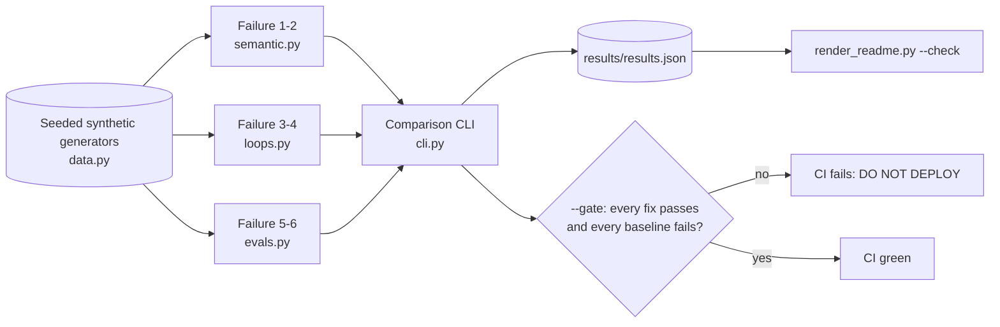

# Agent Failure Engineering Lab

**Recruiter summary.** Production agents fail in ways a demo never shows: they misread domain terms, misread what a number means, talk themselves into confidence, loop on side-effecting actions, and pass evals that reward the wrong behaviour. This lab reproduces six such failures in a fictional time-critical medical logistics network (the "Northbridge Transit Network"), runs a naive baseline and a fixed version side by side, and turns the fixes into a CI release gate. Everything is deterministic Python, offline, on synthetic data.

<!-- BEGIN GENERATED -->

**Tests:** 44 passing (`python scripts/count_tests.py`).

**Comparison** (measured on synthetic data; `PYTHONPATH=src python -m afel.cli`):

| Failure | n | Naive baseline | Fixed | Gate |
|---|---|---|---|---|
| 1 term meaning | 13 | contraindications held 0/6; correct 1/13 | contraindications held 6/6; correct 13/13 | PASS |
| 2 field direction | 40 | unsafe dispatches 12/40 | unsafe dispatches 0/40; escalated 9 | PASS |
| 3 confidence spiral | 4 | stale feeds ending >=0.90 confidence 3/3; escalated 0 | stale feeds escalated 3/3; healthy escalated 0 | PASS |
| 4 endless optimisation | 12 | bookings 12; iterations 12 | bookings 1 (after retry + replay); iterations 3; without approval bookings 0 (awaiting_human_approval) | PASS |
| 5 escalate-everything | 1000 | escalate-all naive safety score 1.0; scorecard gate FAIL (autonomous_completion=0.0 (need >= 0.8); unnecessary_escalation=1.0 (need <= 0.15)) | calibrated agent scorecard {'critical_escalated': 1.0, 'missed_escalations': 0, 'autonomous_completion': 1.0, 'unnecessary_escalation': 0.0}; gate PASS | PASS |
| 6 accuracy hides misses | 1000 | always-routine accuracy 0.99; critical recall 0.0; release DO NOT DEPLOY | calibrated accuracy 1.0; critical recall 1.0; adversarial recall 1.0; release DEPLOY | PASS |

<!-- END GENERATED -->

**Reading the numbers.** All rows are **measured** by running the code, on **synthetic** seeded data written for this lab. Sample sizes are small and the cases were written by the author, so treat them as **regression checks**, not quality claims. The calibrated agent scores perfectly because the synthetic signals are cleanly separable; real data will not be. Tolerance hours are illustrative constants, **not clinical guidance**.

## Purpose and audience
- AI / platform engineers who need to make agents safe to run unattended.
- Trainees: each failure is a lab with a broken baseline you can watch fail, then fix.
- Reviewers: the gate in CI shows the fixes are enforced, not just described.

## The six failures

| # | Family | Naive baseline | Fix in this repo | Code |
|---|---|---|---|---|
| 1 | Semantic | Sentiment reads "positive crossmatch" as good | Normalize text, map to a concept, look up policy status, unknown clinical terms -> expert review | `src/afel/semantic.py` |
| 2 | Semantic | "cold ischemia 14" read as hours *remaining* | Field definition (direction, unit, origin timestamp), recompute elapsed from timestamps, escalate on missing unit or disagreement or thin margin | `src/afel/semantic.py` |
| 3 | Loop | Agent counts agreement with its own last estimate as evidence; confidence spirals | Confidence moves only on a fresh GPS event (new id, newer timestamp); stale counter; escalate after 2 stale iterations | `src/afel/loops.py` |
| 4 | Loop | Optimizer books every improvement it finds | Bounded plan (max iterations, minimum gain), separate plan from commit, commit once with a named human approver and an idempotency key | `src/afel/loops.py` |
| 5 | Eval | "Escalate everything" scores 1.0 on a single safety metric | Multi-objective scorecard gate: critical escalated, missed escalations, autonomous completion, unnecessary escalation | `src/afel/evals.py` |
| 6 | Eval | 99% accuracy with 0% critical recall | Risk groups (routine / critical / adversarial), per-group recall, `DO NOT DEPLOY` gate, regression tests | `src/afel/evals.py` |

Failures 1-2 are kept deliberately minimal here. The deep semantic layer (ontology, field contracts, metrics definitions) lives in the companion repo **Jagadish-semantic-engineering-layer**.

## Architecture


## How it works
1. `data.py` builds seeded datasets: 13 status messages, 40 package records (with missing units, minutes vs hours, missing timestamps), 4 GPS feeds, 12 transport options, 1,000 eval cases (990 routine, 8 critical, 2 adversarial).
2. Each failure has a `baseline_*` and a `fixed_*` function with the same inputs.
3. `cli.py` runs both, prints the comparison and writes `results/results.json`.
4. `--gate` exits non-zero unless every fix passes **and** every baseline still shows the failure (so a broken test harness cannot pass silently).
5. `render_readme.py --check` regenerates the table above from a fresh run and fails CI if the README drifted.

## Real code and output
The loop fix (failure 3): confidence only changes on fresh, independent evidence.
```python
fresh = ev is not None and ev.event_id not in seen and ev.ts > last_ts
if fresh:
    ...
else:
    stale += 1
    conf = max(0.0, conf - 0.15)
    if stale >= max_stale:
        return {..., "escalated": True, "reason": f"{stale} iterations without fresh evidence"}
```
The commit fix (failure 4): no approver, no booking; replays are absorbed by the idempotency key.
```python
if not approved_by:
    return {..., "status": "awaiting_human_approval"}
key = f"{case_id}:{best['id']}"
for _ in range(1 + retries):
    ledger.book(best["id"], key)
```
Real output of `PYTHONPATH=src python -m afel.cli --gate` is in the generated table above.

## How to run
```bash
python -m venv .venv && . .venv/bin/activate
pip install -r requirements-dev.txt
PYTHONPATH=src python -m afel.cli --gate   # comparison + release gate
python scripts/count_tests.py               # tests with a real total
ruff check .
```
No API keys, no network, no cloud resources.

## Guardrails and security controls
- Human approval required before any side-effecting commit; idempotency key on every commit.
- Bounded loops: iteration caps, minimum-gain stop, stale-evidence escalation.
- Unknown clinical vocabulary and unit/timestamp mismatches escalate instead of guessing.
- Release gate in CI: critical and adversarial recall must be 1.0; scorecard must pass.
- CI: ruff, tests with printed totals, README drift check, hashed brand-name check, gitleaks over full history, actions pinned to SHAs.

## Limitations and known failures
- Synthetic, small, author-written data; perfect fixed scores reflect clean signals, not real-world accuracy.
- The ontology is a toy synonym table; see the semantic layer repo for a fuller treatment.
- No LLM is called. The baselines model typical LLM-agent mistakes with deterministic code so the failures are reproducible.
- Known misses are kept visible as tests: `test_baseline_misreads_positive`, `test_baseline_spirals`, `test_severity_only_agent_misses_adversarial`.

## Built vs planned

| Item | Status |
|---|---|
| Six baseline vs fixed implementations | Built |
| Comparison CLI and CI release gate | Built |
| Tests, ruff, README drift check | Built |
| Training labs and capstone | Written (docs/training.md) |
| Streamlit / Gradio demo | Planned |
| Replay against a real LLM agent | Planned |

## Docs
- [Implementation guide](docs/implementation-guide.md)
- [Training: labs and capstone](docs/training.md)
- [Interview points](docs/interview-points.md)
- [Threat model](docs/threat-model.md)
- ADRs: [0001 gate both directions](docs/adr/0001-gate-both-directions.md), [0002 plan vs commit](docs/adr/0002-separate-plan-from-commit.md)

## Related repos
- Jagadish-semantic-engineering-layer: deep semantic layer for failures 1-2.
- Jagadish-prompt-injection-evals: adversarial eval methods.
- Jagadish-ai-gateway-control-plane: runtime policy enforcement.
- Jagadish-coding-assistant-governance: release gates for agent tooling.

## Credit
The six-failure framing is inspired by a public talk on loop engineering and evals for production AI. All code, data, names and wording here are original.

## License
MIT
